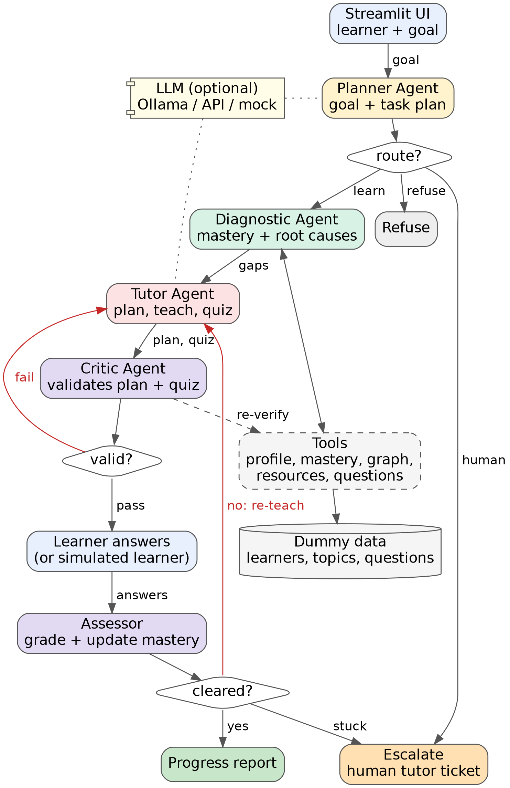

# LearnPath AI: a multi-agent system for personalized learning and knowledge-gap remediation

Proof of concept for **Foundations of Agentic AI**. A Planner, Diagnostic, Tutor and Critic/Assessor agent, orchestrated with LangGraph, find a learner's knowledge gaps and their **root causes**, build a time-boxed study path, teach and quiz the learner, **validate every plan and quiz before it is shown**, and adapt (re-teach or escalate to a human tutor) when the learner is stuck. The UI is Streamlit. It runs on **dummy data** with **no API key** (mock mode), and can optionally use **Ollama** (free, local) or an API model.

## 1. Problem statement and domain justification

Learning builds on earlier learning. A learner who struggles with backpropagation is usually weak in something underneath it (the chain rule, gradient descent, matrix shapes), but the quiz score only says "weak in backpropagation". Courses move at one pace for everyone, tutors cannot diagnose every learner, and learners rarely know which gap to fix first or how long it will really take.

**Problem statement.** Given a learner's goal and time budget, find which gaps matter and why, plan realistic remediation within the time available, teach and assess with feedback, and adapt when the learner does not improve, while making sure the plan and the practice questions are correct before the learner sees them.

**Why personalized learning suits agents**
- The work is a loop (diagnose, plan, teach, assess, adapt), not a single answer.
- Topics form a prerequisite graph, so root-cause analysis is genuinely multi-step reasoning.
- Plans and quizzes can be checked against the data, which makes an explicit Critic useful.
- It needs a human in the loop (the learner's answers) and a human fallback (a tutor).

This matches the Education examples in the brief: student performance analysis and personalised support.

## 2. Existing challenge and proposed solution

| Today | LearnPath AI |
|---|---|
| One syllabus and pace for everyone | Study path built from the learner's own gaps and time budget |
| Quiz score per topic ("weak in backpropagation") | Mastery map plus prerequisite graph: root-cause gaps vs downstream gaps |
| Learner guesses what to study first | Prerequisites first, weakest first, with hours estimated per topic |
| Plans ignore how much time there really is | Honest feasibility: "you need 6.5 h, you have 4 h, extend to 7 days" |
| Failing a quiz means repeating the same material | Re-teach with a new explanation, easier resources and the missed question; two rounds, then a human tutor |
| Generated study content is trusted blindly | A Critic validates every plan and quiz against the source data |

## 3. Agent roles, responsibilities and orchestration

| Agent | Responsibility |
|---|---|
| **Planner** | Parses the goal (topics, days, hours per day) with rules or an LLM, applies privacy and academic-integrity guardrails, routes the request (refuse, escalate or learn) and writes the task plan. |
| **Diagnostic** (research) | Calls tools for the learner profile, mastery map and prerequisite closure. Finds root-cause gaps (not mastered, prerequisites fine) and downstream gaps, and estimates the hours each topic needs. |
| **Tutor** (executor) | Builds the day-by-day study path within the time budget (defers or partly covers what does not fit), writes explanations, prepares quizzes, and re-teaches after a failed quiz. |
| **Critic / Assessor** | Re-derives the facts from raw data to validate each plan and quiz; grades the learner's answers, updates mastery and decides: cleared, re-teach or escalate. |
| **Orchestrator** | LangGraph state machine with a human-in-the-loop pause for the learner's answers, retry loops and escalation tickets. |

**Workflow**
1. Planner parses the goal and routes it. Off-topic requests, other learners' data and requests to do assignments are refused; requests for a human go to a tutor ticket.
2. Diagnostic builds the mastery map and root-cause analysis.
3. Tutor builds the study plan. **Critic validates it** (8 checks). If it fails, the Tutor rebuilds it with the feedback (max 2 attempts), then the case is escalated.
4. For each planned topic: Tutor teaches and prepares a quiz, **Critic validates the quiz** (7 checks), the graph **pauses for the learner's answers**, the Assessor grades and updates mastery.
5. Cleared: next topic. Not cleared: **re-teach** (new explanation, easier resources, the missed question again). Not cleared after 2 rounds: **escalate to a human tutor** and move on.
6. A progress report shows before/after mastery, the study path, practice results and next steps.

**Key rules** (all in code, all explainable)
- Mastery = recency-weighted accuracy over past quizzes. Mastered at 70% or more, shaky 50 to 69%, gap below 50%. Topics with no history are assumed at 40% and flagged *unassessed*.
- Hours needed = estimated hours x (1 - mastery), rounded to the nearest half hour, minimum half an hour.
- Root cause = a topic that needs work and whose prerequisites do not. Everything blocked behind it is downstream.
- Over budget: schedule in prerequisite order until time runs out, partly cover one topic, defer the rest, and say how many days are really needed.
- Cleared = at least 2 of 3 questions correct **and** updated mastery of 70% or more (the latest quiz counts double after studying).
- No gaps: challenge mode with harder questions and a stretch topic that the goal unlocks.

## 4. Architecture



Data flow: goal, then structured goal and task plan, then facts (mastery map, closure), then diagnosis, then a study plan plus quizzes, then a Critic verdict (pass, or feedback to the Tutor), then the learner's answers, then the Assessor's decision, then the report. The Critic re-queries the source data instead of trusting the Tutor, so a wrong number, an impossible schedule or a bad answer key cannot validate itself.

## 5. Proof of concept (Streamlit)

### Run it
```bash
pip install -r requirements.txt
streamlit run app.py            # opens http://localhost:8501
python -m learnpath.evaluation  # scenario tests + Critic fault-injection test, no UI
```
Python 3.10 or newer. In VS Code: open the folder, open a terminal (`` Ctrl+` ``), create a virtual environment, select it with *Python: Select Interpreter*, then run the commands above.

### Optional LLM: Ollama (free, local) or an API
1. Install Ollama from ollama.com and pull a model: `ollama pull llama3.1` (or a smaller one such as `llama3.2` if your laptop is short on memory).
2. `pip install langchain-ollama`
3. In the app sidebar choose **ollama**, press **Check Ollama connection**, pick the installed model.
4. For the Anthropic API instead: `pip install langchain-anthropic`, put `ANTHROPIC_API_KEY=...` in a `.env` file (copy `.env.example`) and choose **anthropic**.

| Agent | What the LLM may do | If it fails or is switched off |
|---|---|---|
| Planner | Parse a free-text goal into topics and a time budget (structured output) | Rule-based parser |
| Tutor | Write the explanation for each topic and each re-teach round | Template built from the topic notes |
| Tutor | Write extra practice questions (off by default, slower) | Curated question bank |
| Critic | Answer an LLM-written question independently to verify its answer key | The question is rejected |

Safety rules stay in code: privacy and integrity guardrails are decided by rules, the learner never sees answer keys, LLM explanations are guard-checked (length, on-topic) and every LLM call is counted in the trace. Small local models sometimes cannot produce structured output; the app then falls back to rules and says so.

### UI
Sidebar: learner, model mode (mock, ollama, anthropic), what the LLM may do, practice mode (**answer yourself** or **autopilot with a simulated learner**) and a **faulty first drafts** switch that deliberately corrupts the first study plan and the first quiz so you can watch the Critic reject them.
Tabs: **Learning path**, **Knowledge gaps** (prerequisite graph coloured by mastery, at the start and now), **Practice** (study material, quiz form, instant feedback), **Report**, **Agent trace**, **Critic validation**, **Architecture**, **Evaluation**.

### Dummy data (`data/`)
12 machine-learning topics in a prerequisite graph, 60 multiple-choice questions (5 per topic, difficulty 1 to 3), 48 study resources and 4 learners.

| ID | Learner | Goal | Designed to show |
|---|---|---|---|
| L001 | Ananya Rao | Backpropagation, 10 days x 1.5 h | Root causes (calculus, linear algebra) behind a hard topic; Gradient Descent needs a re-teach |
| L002 | Rahul Mehta | Model evaluation and regularization, 5 days x 1 h | One root cause (evaluation) blocking another topic |
| L003 | Sneha Iyer | Linear regression, 4 days x 1 h | Not enough time (needs 6.5 h, has 4 h); a stuck topic escalated to a human tutor |
| L004 | Karan Shah | Neural networks, 3 days x 1 h | No gaps: challenge mode, a second round, and a stretch topic |

## 6. Output validation, results, limitations and future scope

**Plan checks (8)**, recomputed from raw data: total hours; prerequisites scheduled before dependents; time budget (total and per day); no time on mastered topics; every root cause covered or openly deferred; resources exist, match the topic and suit the level; feasibility disclosed honestly; hours per topic match the diagnosis.
**Quiz checks (7):** valid format and answer key; right topic; count and difficulty; no duplicates; explanations present; unseen or previously missed questions only; and, for LLM-written questions, an independent self-check of the answer key.

**Results** (mock mode, `python -m learnpath.evaluation`)

| Test | Outcome |
|---|---|
| 11 scenarios: 5 learning paths, 4 refusals (other learner, off-topic, assignment request, unknown topic), 1 human-tutor request, 1 early stop | **11/11 passed** |
| Fault injection: a corrupted first study plan and a corrupted first quiz in each of 5 learning-path scenarios | **5/5 rejected by the Critic and recovered**, with the same outcome as the clean run |
| Question picker sweep: every topic, difficulty pattern and missed-question combination (288 quizzes) | 288/288 pass the Critic |

Example journey (L001, simulated learner): Calculus 30% to 77%, Linear Algebra 60% to 87%, Linear Regression 50% to 83%, Gradient Descent 30% to 77% (after one re-teach round), Neural Networks 40% to 80%, Backpropagation 40% (assumed) to 100%. L003: plan honestly short by 2.5 h, Linear Regression deferred, Calculus escalated to a tutor after two failed rounds.

These are functional tests on dummy data with a simulated learner. They show that the workflow, routing and validation behave as designed. They do not measure learning outcomes with real learners.

**Limitations**
- Dummy data and a simulated learner for evaluation; no real learners or learning gains were measured.
- Mock mode uses keyword rules for goals and templates for explanations. Real LLM output was exercised only with a stub model and an unreachable server during development, so test your own Ollama model before presenting.
- Mastery is a simple estimate from a few quizzes; the question bank is small (5 per topic).
- The Critic catches wrong plans and malformed questions, not weak teaching. Question correctness for LLM-written items rests on a self-consistency check, not ground truth.
- Learner ID is a UI selection; a real system needs authentication.

**Future scope**
- Real course content and a larger question bank; spaced-repetition review of cleared topics.
- Retrieval over lecture notes (RAG) for explanations; MCP servers for the LMS and calendar.
- Better mastery models (item response theory or Bayesian knowledge tracing) and open-ended answers graded with a rubric.
- A pilot with real learners, LangSmith tracing, and an LLM judge next to the rule-based Critic.

## 7. Project layout
```
app.py                    Streamlit UI
learnpath/tools.py        data loading, mastery maths, LangChain tools
learnpath/planner.py      Planner: goal parsing, guardrails, task plan
learnpath/diagnosis.py    Diagnostic: gaps, root causes, hours
learnpath/tutor.py        Tutor: study plan, explanations, quizzes
learnpath/critic.py       Critic: plan and quiz validation
learnpath/assessor.py     Assessor: grading and the clear / re-teach / escalate decision
learnpath/workflow.py     LangGraph orchestration (with human-in-the-loop pause)
learnpath/session.py      start / resume / autopilot drivers
learnpath/simulator.py    simulated learner for demos and evaluation
learnpath/llm.py          optional Ollama / API support with call counting
learnpath/evaluation.py   scenario tests and fault-injection test
learnpath/report.py, viz.py, diagram.py
data/                     topics, questions, resources, learners (dummy)
docs/architecture.png
```
